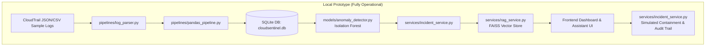

# CloudSentinel AI - System Architecture Specification

## 1. Executive Architecture Summary
CloudSentinel AI integrates four domains into a cohesive, threat-detection and autonomous incident response platform:
1. **Cloud Engineering**: AWS CloudTrail ingestion, IAM least-privilege policies, and assisted containment simulation.
2. **Data Engineering**: Data cleaning, schema normalization, deduplication, feature extraction (Pandas & PySpark Glue blueprint).
3. **Machine Learning**: Unsupervised anomaly detection via Isolation Forest (scikit-learn) with explainable feature attribution.
4. **Generative AI**: Retrieval-Augmented Generation (RAG) assistant leveraging a local FAISS vector index over AWS security runbooks.

---

## 2. Architecture Comparison: Local Prototype vs Proposed AWS Enterprise

```mermaid
graph TD
    subgraph "Target AWS Enterprise Architecture (Proposed Extension)"
        AWS_CT[AWS CloudTrail Multi-Region] --> S3_RAW[Amazon S3: Raw Audit Logs]
        S3_RAW --> EVT_BRIDGE[Amazon EventBridge]
        EVT_BRIDGE --> LAMBDA_INGEST[AWS Lambda Ingestion Function]
        LAMBDA_INGEST --> STEP_FN[AWS Step Functions SOAR Orchestrator]
        STEP_FN --> GLUE_ETL[AWS Glue 4.0 PySpark ETL Job]
        GLUE_ETL --> S3_PARQUET[Amazon S3 Analytics Lake: Parquet]
        GLUE_ETL --> REDSHIFT[Amazon Redshift Data Warehouse]
        REDSHIFT --> SAGEMAKER[Amazon SageMaker: Isolation Forest Model]
        SAGEMAKER --> DYNAMO_INC[Amazon DynamoDB: Incidents]
        DYNAMO_INC --> BEDROCK[AWS Bedrock / Gemini API: RAG Assistant]
        BEDROCK --> API_GW[Amazon API Gateway]
        API_GW --> CLOUD_UI[CloudSentinel Monitoring Dashboard]
        API_GW --> LAMBDA_REMEDIATE[AWS Lambda Containment Functions]
        LAMBDA_REMEDIATE --> CW_AUDIT[Amazon CloudWatch &amp; KMS]
    end
```

---

## 3. Subsystem Breakdown

### A. Data Engineering & ETL Pipeline
- **Log Parsing (`pipelines/log_parser.py`)**:
  - Validates ISO-8601 UTC timestamps and required event fields (`eventName`, `eventSource`).
  - Supports both CloudTrail JSON (single record or `{"Records": [...]}`) and CSV.
- **Normalization & Deduplication (`pipelines/pandas_pipeline.py`)**:
  - Classifies IP addresses against RFC 1918 VPC subnets (10.0.0.0/8, 172.16.0.0/12, 192.168.0.0/16, 127.0.0.1).
  - Eliminates duplicate events by `eventID` across both in-flight batch and historical SQLite records.
  - Generates comprehensive ETL accounting metrics (`total_records`, `processed_records`, `duplicate_records`, `rejected_records`, `duration_seconds`).
- **Distributed PySpark Job (`pipelines/pyspark_pipeline.py`)**:
  - Production AWS Glue script with schema definitions, windowed frequency aggregations, date partitioning, and Redshift JDBC sink connector design.

### B. Machine Learning Anomaly Detection
- **Model**: `sklearn.ensemble.IsolationForest`
- **Features Extracted**:
  1. `is_internal_ip`: 1 for VPC private IP, 0 for external internet IP
  2. `is_error`: 1 if error occurred, 0 for successful execution
  3. `is_privilege_related`: 1 for IAM policy or role modification
  4. `is_auth_failure`: 1 for failed console authentication
  5. `is_tampering`: 1 for defense evasion (e.g. StopLogging, DeleteTrail)
  6. `is_write_action`: 1 for mutating API calls, 0 for read-only
  7. `hour_of_day_norm`: normalized time of day (0.0 - 1.0)
  8. `is_off_hours`: 1 if executed between 20:00 and 07:00 UTC
  9. `user_type_risk`: root identity (1.0), assumed role (0.5), IAM user (0.2)
  10. `event_rarity_score`: inverse historical event frequency
- **Explainability**:
  - Computes directional feature divergence comparing the observed event against baseline normal means, producing SHAP-like attribution percentages for SOC analysts.

### C. Generative AI RAG Security Assistant
- **Vector Index**: FAISS (`IndexFlatIP`) with dense TF-IDF L2-normalized projections.
- **Knowledge Base**: Curated Markdown playbooks covering IAM privilege escalation, CloudTrail evasion, brute force authentication, S3 data exfiltration, security group ingress, and containment runbooks.
- **Inference**:
  - Configurable providers: Google Gemini (`gemini-2.0-flash` via `google-genai`), OpenAI, or local Fallback Demonstration Engine.
  - Transparent labeling: Explicitly labels Fallback Demonstration Engine when external API key is absent.

### D. Incident Management & Assisted Containment
- **Lifecycle**: Open &rarr; Investigating &rarr; Resolved &rarr; False Positive.
- **Simulated Actions**:
  - `REVOKE_SESSION`: Invalidate active AWS STS session tokens.
  - `QUARANTINE_ROLE`: Attach `AWSCompromisedKeyQuarantine` or DenyAll inline policy.
  - `ROTATE_KEY`: Deactivate exposed programmatic credentials.
  - `ISOLATE_IP`: Create VPC Network ACL deny rule.
  - `RESTORE_LOGGING`: Re-enable halted CloudTrail trails.
- **Audit Logging**: Every action, actor, timestamp, and target recorded into `audit_trail` table.
