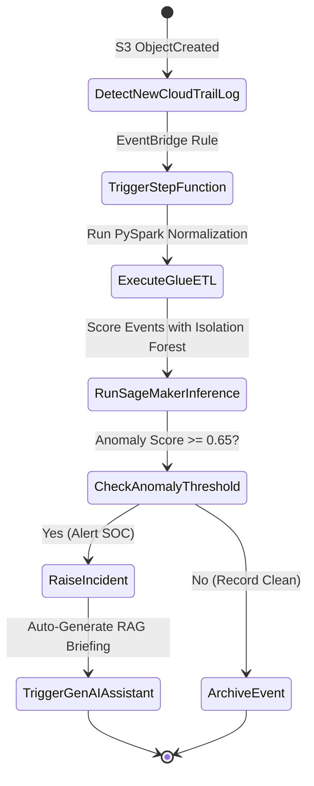

# CloudSentinel AI - AWS Enterprise Deployment Guide

This document details how to extend the local CloudSentinel AI prototype to production AWS infrastructure.

---

## 1. Prerequisites & IAM Setup
To run CloudSentinel AI within an AWS Organization:
1. **IAM Role for Log Collection**:
   - Create an IAM role `CloudSentinel-Ingestion-Role` with read access to the centralized CloudTrail S3 bucket:
   ```json
   {
     "Version": "2012-10-17",
     "Statement": [
       {
         "Effect": "Allow",
         "Action": ["s3:GetObject", "s3:ListBucket"],
         "Resource": [
           "arn:aws:s3:::organization-cloudtrail-logs",
           "arn:aws:s3:::organization-cloudtrail-logs/*"
         ]
       }
     ]
   }
   ```
2. **KMS Encryption**:
   - Ensure the ingestion role has `kms:Decrypt` permissions on the AWS KMS key encrypting CloudTrail log archives.

---

## 2. AWS Glue & PySpark Setup
1. **Upload PySpark Job Script**:
   - Copy `pipelines/pyspark_pipeline.py` to an S3 bucket: `s3://cloudsentinel-artifacts/scripts/pyspark_pipeline.py`.
2. **Configure AWS Glue 4.0 Job**:
   - Name: `CloudSentinel-CloudTrail-ETL-Job`
   - Worker Type: `G.1X` (10 workers)
   - Glue Version: `4.0`
   - Default Arguments:
     * `--INPUT_S3_PATH`: `s3://organization-cloudtrail-logs/AWSLogs/`
     * `--OUTPUT_S3_PATH`: `s3://cloudsentinel-analytics-lake/normalized_events/`
     * `--REDSHIFT_JDBC_URL`: `jdbc:redshift://cluster.us-east-1.redshift.amazonaws.com:5439/security_dw`

---

## 3. Serverless Orchestration (Step Functions & Lambda)


---

## 4. Environment Variables Configuration
In production EC2, ECS, or App Runner environments, set the following environment variables:
```bash
AWS_ENABLED=True
AWS_REGION=us-east-1
AWS_CLOUDTRAIL_BUCKET=organization-cloudtrail-logs
AWS_DYNAMODB_TABLE=CloudSentinel-Incidents
AWS_KMS_KEY_ID=alias/cloudsentinel-key
LLM_PROVIDER=gemini # or bedrock
GEMINI_API_KEY=your-gemini-api-key
```
